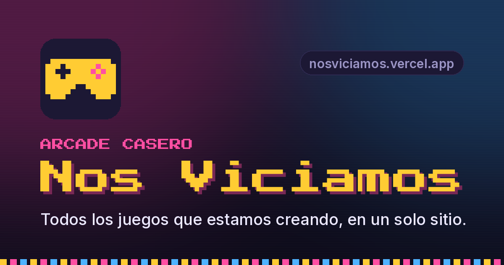

<p align="center">
  <a href="https://nosviciamos.vercel.app">
    
  </a>
</p>

<h1 align="center">Nos Viciamos</h1>

<p align="center">
  Todos los juegos que estamos creando, en un solo sitio.<br>
  <a href="https://nosviciamos.vercel.app"><b>nosviciamos.vercel.app</b></a>
</p>

---

## Juegos

| Juego | De qué va | Tipo | Jugar |
|---|---|---|---|
| 🕵️ **El Impostor** | Todos conocen la palabra secreta… menos el impostor. De 3 a 20 jugadores pasando el móvil, con 6 modos. | Fiesta · Multijugador | [theimpostorgamer.vercel.app](https://theimpostorgamer.vercel.app) |
| 🔐 **Escape 3D** | Escape rooms en 3D para el móvil: enigmas contra el reloj y ranking. | Puzle · 3D | [scaperooms.vercel.app](https://scaperooms.vercel.app) |
| 📜 **Legado · Historia Negra** | Juego educativo de historia negra: trivia, línea del tiempo, ¿Quién soy? y un archivo de historias. | Preguntas · Educativo | [blackhistorygame.vercel.app](https://blackhistorygame.vercel.app) |
| 🎃 **Noche de Halloween** | Preguntas de Halloween para 2 a 10 jugadores: la sala en la tele y cada uno con su móvil de mando. | Fiesta · Preguntas · Online | [hallowquest.vercel.app](https://hallowquest.vercel.app) |
| 🃏 **UNO 3D** | El clásico UNO en 3D, multijugador en local, pasando el móvil o contra bots. | Cartas · 3D · Multijugador | [unogame3d.vercel.app](https://unogame3d.vercel.app) |
| 🍻 **Yo Nunca** | 180 frases de «Yo nunca» para leer en voz alta, de normales a muy picantes (+18). | Fiesta · Multijugador | [yonuncagame.vercel.app](https://yonuncagame.vercel.app) |

Cada juego vive en su propia web; el portal solo los reúne y enlaza.

## La web

- Buscador por nombre, descripción, género o autor.
- Filtros por tipo: Fiesta, Multijugador, Online, Preguntas, Cartas y Puzles.
- Juegos ordenados por nombre; cada tarjeta abre el juego en una pestaña nueva.
- Lista para compartir: favicon, miniatura para WhatsApp/X/Discord e instalable en la pantalla de inicio.

Es HTML, CSS y JavaScript sin dependencias ni paso de compilación.

## Añadir un juego

Si el juego ya está publicado en otra web, añade su ficha a [`games.js`](games.js):

```js
{
  "slug": "mi-juego",
  "titulo": "Mi juego",
  "descripcion": "Una o dos frases.",
  "estado": "beta",                       // "desarrollo" | "beta" | "terminado"
  "generos": ["fiesta", "multijugador"],
  "autores": [],
  "emoji": "🎲",
  "colores": ["#6c5ce7", "#d63031"],      // degradado de la portada
  "url": "https://mi-juego.vercel.app/"
}
```

Los géneros `fiesta`, `multijugador`, `online`, `trivia`, `cartas` y `puzle` hacen que aparezca en el filtro correspondiente (se definen en `TIPOS`, en [`app.js`](app.js)).

Para empezar un juego nuevo dentro de este repo:

```bash
node nuevo-juego.mjs "Nombre del juego" --autor "Ana" --genero arcade,puzle --estado desarrollo
```

Crea `games/<slug>/index.html` a partir de [`plantilla/`](plantilla/) y añade su ficha a `games.js`.

## En local

```bash
python3 -m http.server 8765
```

Y abre http://localhost:8765.

## Estructura

```
index.html, styles.css, app.js   el portal
games.js                         lista de juegos
nuevo-juego.mjs                  script para crear un juego nuevo
plantilla/index.html             punto de partida para juegos nuevos
favicon.*, icon-*.png,           iconos
apple-touch-icon.png
og-image.png                     miniatura al compartir el enlace (1200×630)
site.webmanifest                 datos para instalarla en el móvil
```

## Despliegue

Cada push a `main` se publica automáticamente en Vercel en [nosviciamos.vercel.app](https://nosviciamos.vercel.app).
